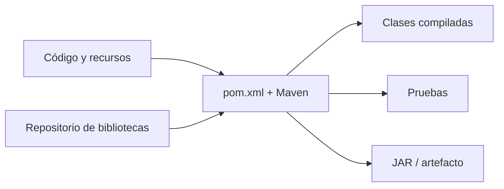

# 1. Qué es Apache Maven

**Al finalizar podrás:** explicar qué automatiza Maven y distinguirlo de Java, del IDE y de Git.

## El problema antes de Maven

Imagina una aplicación que necesita una biblioteca para procesar JSON. Sin herramienta de construcción tendrías que localizar el JAR, descargarlo, incluirlo en el classpath, repetir el proceso con sus dependencias y dar instrucciones diferentes según el IDE.

**Maven** es una herramienta de *automatización de la construcción* de proyectos, especialmente Java. Utiliza un **modelo de proyecto** (`pom.xml`) y convenciones para gestionar dependencias, compilar, probar, empaquetar y publicar artefactos.

## Conceptos esenciales

| Concepto | Qué es | Ejemplo |
|---|---|---|
| JDK | Compilador y herramientas Java | `javac`, `java` |
| Maven | Orquestador de construcción | `mvn package` |
| IDE | Editor y herramientas de desarrollo | VS Code, Eclipse |
| Git | Control de versiones | `git commit` |
| Dependencia | Biblioteca usada por el proyecto | Gson |
| Artefacto | Resultado identificable de la construcción | `calculadora-1.0.jar` |

Maven **no sustituye** al JDK, al IDE ni a Git. Los complementa. Una ventaja importante es que el mismo `pom.xml` se puede usar desde la terminal, un IDE o integración continua.

## Construcción reproducible

Un proyecto es más reproducible si especifica versiones de Java, dependencias y plugins. Sin embargo, reproducibilidad absoluta también requiere controlar el entorno, los repositorios y las versiones de las herramientas.

## Maven frente a Gradle

Ambos automatizan construcciones. Maven prioriza un modelo declarativo XML y convenciones estables; Gradle emplea scripts y permite personalizaciones diferentes. Este curso usa Maven para centrarse en conceptos transferibles a otras herramientas.

## Comprueba que lo entiendes

**1.** ¿Puede Maven compilar un proyecto si no hay un JDK adecuado instalado?

??? success "Solución 1"
    No. Maven se ejecuta sobre Java y necesita herramientas de compilación adecuadas. `mvn -version` muestra la versión de Java con la que se está ejecutando.

**2.** ¿Por qué es útil compartir `pom.xml` en Git?

??? success "Solución 2"
    Porque permite que otra persona recupere dependencias y reproduzca fases de construcción sin intercambiar manualmente los JAR de terceros.

---

!!! tip "Cómo estudiar este apartado"
    Ejecuta los comandos en un proyecto de pruebas, anota el resultado y despliega la solución solo después de intentarlo.
