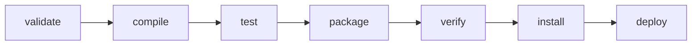

# 8. Ciclo de vida

!!! info "Dónde encaja este capítulo"
    Ya sabemos qué es un POM y cómo se organiza un proyecto. Ahora veremos **qué ocurre cuando escribimos una orden Maven**. Es importante entenderlo antes de estudiar dependencias y plugins: Maven no ejecuta cada comando de forma aislada, sino que recorre fases del ciclo de vida.


**Al finalizar podrás:** explicar qué ejecuta cada fase y por qué `package` incluye pruebas.

## No son comandos independientes

Maven tiene ciclos de vida. El más usado es `default`, con fases ordenadas. Si ejecutas una fase, Maven ejecuta también las fases anteriores necesarias **del mismo ciclo**.



La figura simplifica el ciclo para mostrar los hitos más utilizados: existen fases intermedias como `process-resources`, `test-compile` o `integration-test`.

| Fase | Resultado habitual |
|---|---|
| `validate` | Verifica información básica del proyecto |
| `compile` | Compila clases principales |
| `test` | Ejecuta pruebas unitarias |
| `package` | Genera el JAR/WAR |
| `verify` | Ejecuta comprobaciones adicionales configuradas |
| `install` | Copia el artefacto al repositorio local |
| `deploy` | Publica en un repositorio remoto configurado |

## El ciclo `clean`

`mvn clean` invoca otro ciclo y borra los resultados de compilaciones anteriores, normalmente `target/`.

```bash
mvn clean package
```

En esta orden Maven ejecuta primero `clean` y después las fases necesarias hasta `package`.

## ¿Qué relación tiene Maven con JUnit?

JUnit es una biblioteca externa para escribir pruebas Java; **no es una parte de Maven**. Maven, por su parte, organiza cuándo deben compilarse y ejecutarse las pruebas. Por eso en este curso solo veremos cómo se conectan ambas herramientas, sin estudiar técnicas de diseño de pruebas.

En un proyecto Maven convencional, las clases de prueba se colocan en `src/test/java`. Para utilizar JUnit 5, declaramos una dependencia de pruebas en `pom.xml`. Por ejemplo:

```xml
<dependencies>
    <dependency>
        <groupId>org.junit.jupiter</groupId>
        <artifactId>junit-jupiter</artifactId>
        <version>5.11.4</version>
        <scope>test</scope>
    </dependency>
</dependencies>
```

El valor `test` indica que la dependencia se necesita para compilar y ejecutar las pruebas, no como biblioteca de ejecución habitual de nuestra aplicación. Maven utiliza el **Maven Surefire Plugin** para ejecutar pruebas unitarias durante la fase `test`. Si trabajas con JUnit 5, conviene fijar una versión moderna de Surefire:

```xml
<build>
    <plugins>
        <plugin>
            <groupId>org.apache.maven.plugins</groupId>
            <artifactId>maven-surefire-plugin</artifactId>
            <version>3.5.2</version>
        </plugin>
    </plugins>
</build>
```

Para comprobar el comportamiento:

```bash
mvn test
```

Cuando existen pruebas compatibles, Maven informa de cuántas se han ejecutado y de sus resultados. Los informes suelen aparecer en `target/surefire-reports/`. Si no hay pruebas, el resultado puede indicar que no se ha ejecutado ninguna; **`BUILD SUCCESS` no significa por sí solo que existan pruebas**.

??? success "Comprobación: ¿es JUnit una herramienta de Maven?"
    No. JUnit es un framework de pruebas. Maven puede descargarlo como dependencia y ejecutar sus pruebas mediante un plugin, pero cada herramienta tiene su propia función.

## Saltar pruebas: no confundir opciones

`-DskipTests` normalmente omite la ejecución de pruebas, pero permite compilarlas; `-Dmaven.test.skip=true` puede omitir también su compilación. **No son una solución a pruebas que fallan**: se utilizan excepcionalmente y con conocimiento de sus efectos.

## Ejercicio

¿`mvn install` sube tu proyecto a GitHub?

??? success "Mostrar solución"
    No. `install` publica el artefacto en el repositorio Maven local (`~/.m2/repository` o su equivalente). `git push` publica commits en Git; `mvn deploy` requiere un repositorio Maven remoto configurado.

---

!!! tip "Cómo estudiar este apartado"
    Ejecuta los comandos en un proyecto de pruebas, anota el resultado y despliega la solución solo después de intentarlo.
